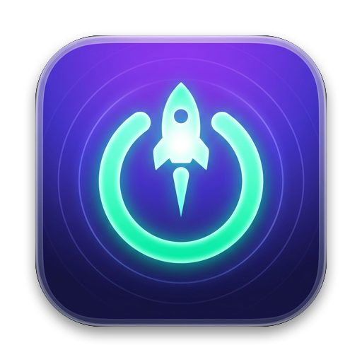
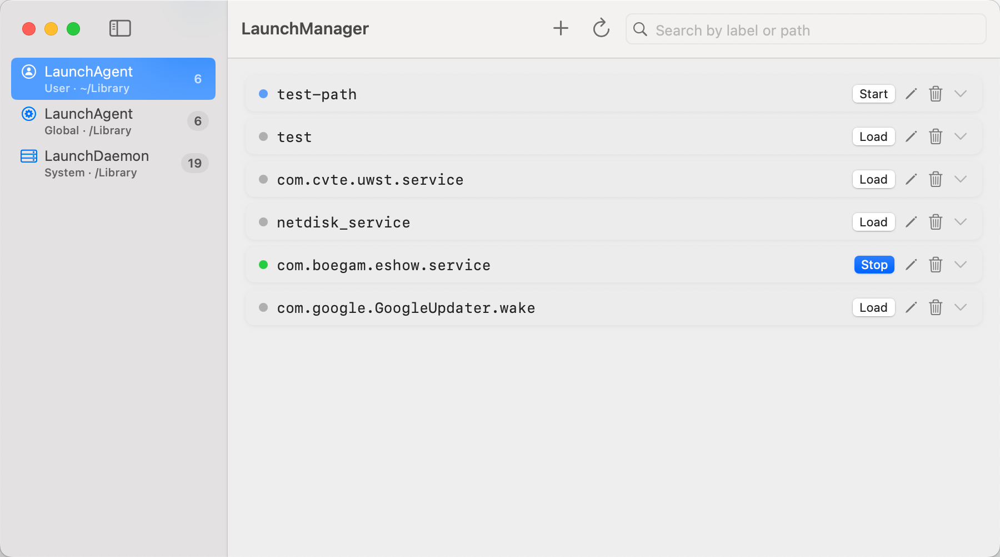

<p align="center">
  
</p>

<h1 align="center">Bootayar</h1>

<p align="center">
  <strong>macOS Startup & Automation Manager</strong><br/>
  Manage startup apps, background services, and scheduled tasks.
</p>

<p align="center">
  
  
  
  
</p>

Bootayar is a native macOS app for inspecting and managing `launchd` agents, daemons, cron jobs, and local listening ports in one place.



## Features

- **Launch Agents & Daemons** - Browse User Agents, Global Agents, and System Daemons. Edit with the form view or raw XML.
- **Run Control** - Load, unload, start, and stop jobs directly. System-level changes prompt for admin access when needed.
- **Schedules & Triggers** - Configure calendar schedules, intervals, `WatchPaths`, and `RunAtLoad` rules.
- **Crontab** - View and edit user and `/etc/crontab` entries without touching the terminal.
- **Local Services** - See active TCP listeners, Homebrew services, and published Docker ports.
- **Logs** - Inspect `stdout`/`stderr` log files and recent system log entries inline.

## Requirements

- macOS 14 Sonoma or later
- Xcode 16+ (to build from source)

## Installation

### Download DMG

Grab the latest **Bootayar.dmg** from [Releases](https://github.com/themanoftalent/Bootayar/releases), open it, and drag **Bootayar** to **Applications**.

> On first launch, right-click the app and choose **Open**.

### Homebrew

```bash
brew tap themanoftalent/tap
brew install --cask bootayar
```

### Build from Source

```bash
git clone https://github.com/themanoftalent/Bootayar.git
cd Bootayar
open Bootayar.xcodeproj
```

Build and run in Xcode (`⌘R`), or package a release DMG with `./scripts/build-dmg.sh`.

## Project Layout

```
Bootayar/
├── Models/      # Data models for launch items, cron jobs, and services
├── Services/    # launchctl, plist, crontab, and port discovery logic
├── Store/       # Observable state stores
├── Utilities/   # Theme colors and shared UI styles
└── Views/       # SwiftUI views
```

## License

MIT - see [LICENSE](LICENSE).
